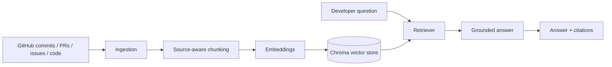

# Bug Archaeology

**Ask a codebase what happened before — and why.**

Bug Archaeology is a small, working RAG assistant for exploring repository history. It turns commits, pull requests, issues and code into searchable evidence, then answers questions with source links.

## What it does
- Ingest repository history from the GitHub REST API (or use the included sample dataset).
- Split each source into searchable chunks while keeping metadata such as source type, date, author and URL.
- Create embeddings and store them in ChromaDB when the optional vector stack is enabled.
- Retrieve relevant evidence and generate a grounded answer. The demo works without API keys using sample evidence.
- Show retrieved sources so a developer can verify the answer.

## Architecture



## Stack
- Backend: Python, FastAPI, Pydantic
- Retrieval: ChromaDB + sentence-transformers (optional local vector mode)
- Demo fallback: lightweight keyword retrieval over included sample records
- LLM: optional Ollama endpoint; otherwise a transparent extractive answer from retrieved evidence
- Frontend: React + Vite

> The included sample data is illustrative, not a claim about a real production repository. Add a GitHub token and repository name to ingest a real repository.

## Run locally

### 1. Backend
```bash
cd backend
python -m venv .venv
# Windows: .venv\\Scripts\\activate
# macOS/Linux: source .venv/bin/activate
pip install -r requirements.txt
cp .env.example .env
uvicorn app.main:app --reload
```
API docs: http://localhost:8000/docs

### 2. Frontend
```bash
cd frontend
npm install
npm run dev
```
Open the Vite URL shown in your terminal. The dashboard includes a sample-mode demo and uses the API when it is available.

## Ingest a repository
Set `GITHUB_TOKEN` and `GITHUB_REPO=owner/name` in `backend/.env`, then call:
```bash
curl -X POST http://localhost:8000/ingest
```
The token is optional for public repositories, but recommended to avoid low API rate limits.

## Example questions
- Why was the payment retry limit reduced?
- Has the timeout bug happened before?
- Which change introduced the cache invalidation?
- What was the reasoning behind the authentication fallback?

## Project structure
```text
backend/
  app/
    main.py        # FastAPI endpoints
    ingest.py      # GitHub ingestion and source-aware chunking
    retrieval.py   # search, optional Chroma and grounded response
    schemas.py     # API models
    sample_data.json
  requirements.txt
  .env.example
frontend/
  src/
    main.jsx
    styles.css
  index.html
  package.json
  vite.config.js
```

## Current scope
This is an interview-sized prototype: one repository at a time, a compact ingestion pipeline, simple retrieval and cited answers. For a production deployment, add background jobs, incremental sync checkpoints, access control, evaluation datasets and monitoring.
