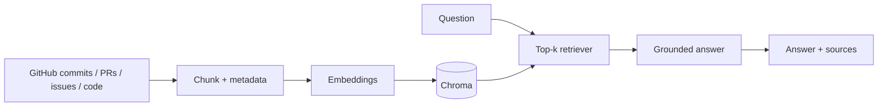

# Bug Archaeology

A conversational RAG assistant that searches repository commits, pull requests, issues and code to explain why code exists.

## Run locally

```bash
python -m venv .venv
# Windows: .venv\\Scripts\\activate
# macOS/Linux: source .venv/bin/activate
pip install -r requirements.txt
uvicorn app.main:app --reload
```

Open http://127.0.0.1:8000. Six sample history records are indexed automatically; no API key is required.

## Architecture



FastAPI serves the API and frontend. Chroma stores vectors locally using its default embedding function. An optional OpenAI key enables generated answers; without it, an evidence-based response is returned. The UI includes a working chat, source links and public GitHub repository indexing.

## Stack
- Python, FastAPI
- ChromaDB and default embedding function
- OpenAI API (optional)
- HTML, CSS and JavaScript

## API
- GET /api/health — status and index size
- GET /api/sources — indexed records
- POST /api/ask — retrieve and answer
- POST /api/index/github — index public commits, PRs and issues

This is an interview-sized prototype. Authentication, background jobs, webhooks and advanced hybrid search are intentionally out of scope.
